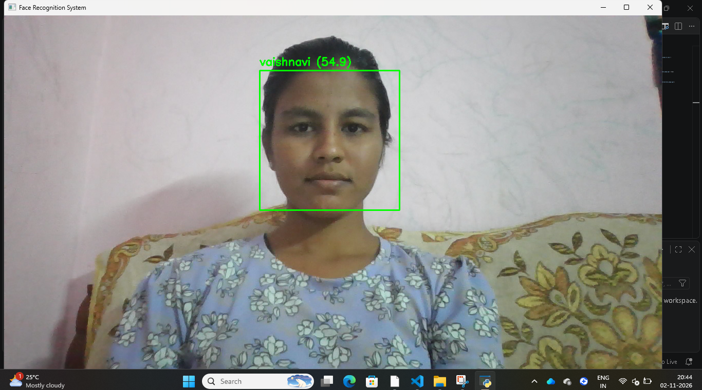
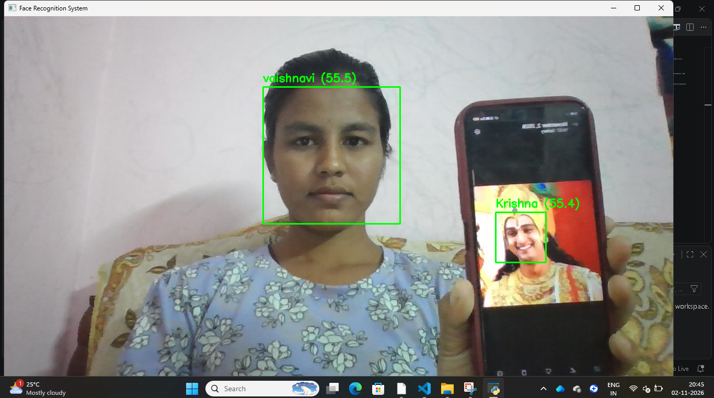
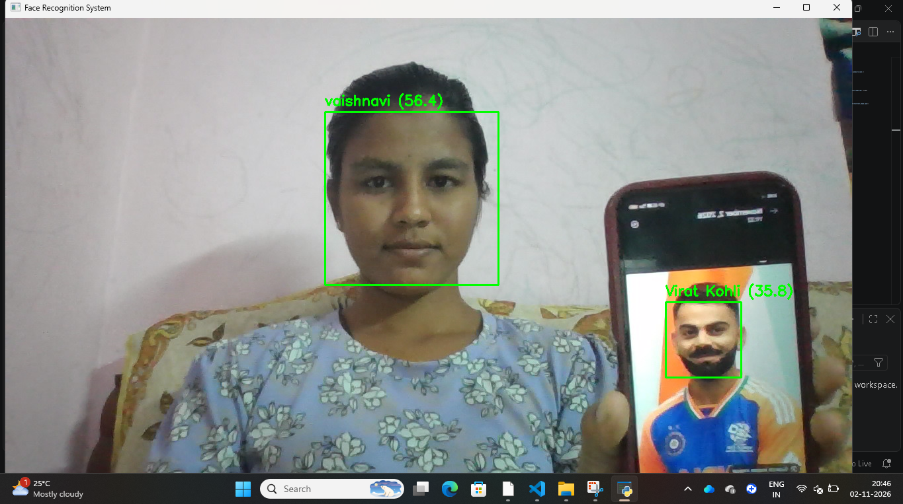

# Face Detection and Recognition System

## Overview

The Face Detection and Recognition System is a Python-based computer vision application developed using OpenCV. It detects human faces through a webcam and recognizes registered identities using the Local Binary Patterns Histograms (LBPH) algorithm.

The project demonstrates how face detection and face recognition can be implemented using classical computer vision techniques.

## Features

- Real-time face detection using Haar Cascade Classifier.
- Face image registration and dataset creation.
- Face recognition using the LBPH algorithm.
- Recognition of multiple registered identities.
- Unknown face detection based on a configurable confidence threshold.
- Webcam-based face detection and recognition.
- Automatic model training and label mapping.

## Technologies Used

- Python
- OpenCV
- NumPy
- Haar Cascade Classifier
- LBPH Face Recognizer

## Project Structure

```text
face-detection-recognition/
│
├── dataset/
│   ├── vaishnavi/
│   ├── Krishna/
│   └── Virat Kohli/
│
├── models/
│   ├── face_model.yml
│   └── labels.txt
│
├── screenshots/
│
├── main.py
├── register_faces.py
├── train_model.py
├── requirements.txt
├── .gitignore
└── README.md
```
## Screenshots

## Screenshots

### Vaishnavi Recognition


### Krishna Recognition


### Virat Kohli Recognition


## Installation

### 1. Clone the repository

```bash
git clone YOUR_GITHUB_REPOSITORY_URL
```

### 2. Navigate to the project directory

```bash
cd face-detection-recognition
```

### 3. Install dependencies

```bash
pip install -r requirements.txt
```

## How to Run

### Step 1: Register face images

```bash
python register